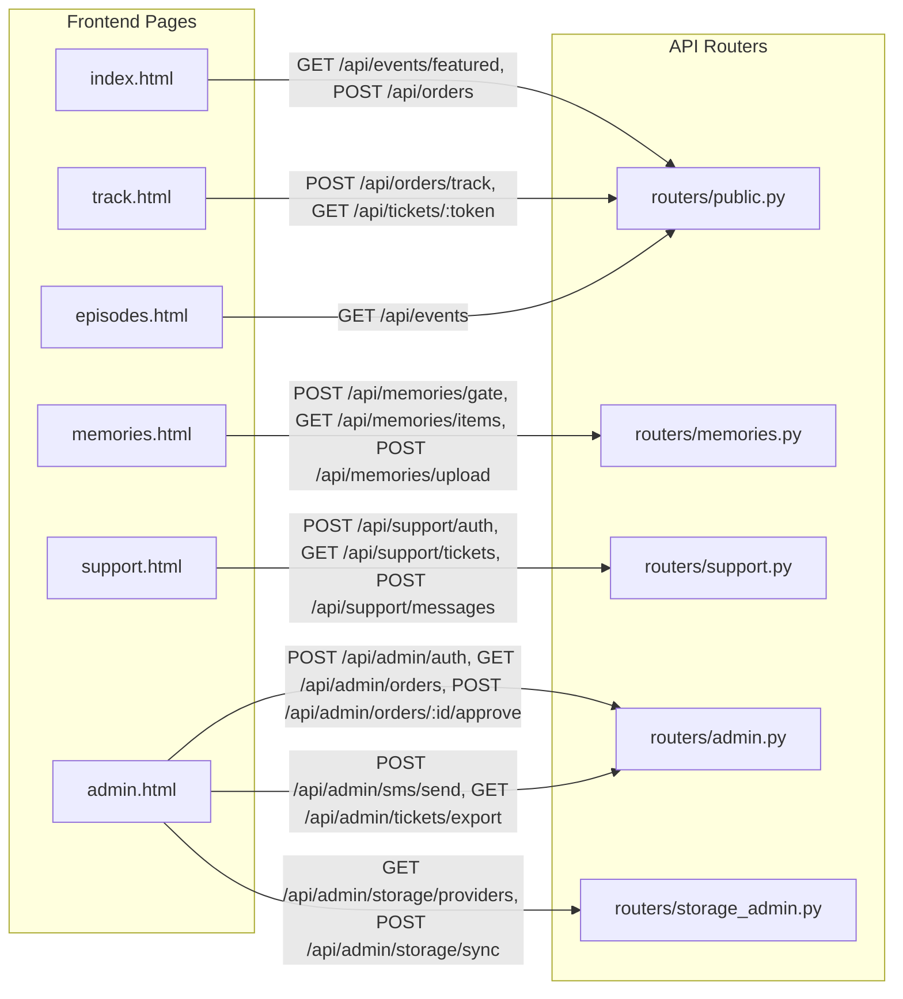
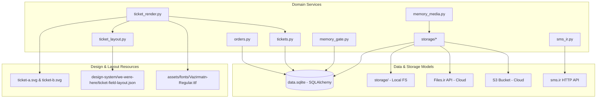

# WE WERE HERE — Complete Dependency Map

> **Audit Date:** 2026-11-08  
> **Repository:** `WE WERE HERE` (`wewerehere`)

---

## 1. Frontend Pages to Asset Dependencies

Every frontend page runs directly in the browser and loads specific shared CSS and JS assets from the root or `/assets/` directory:

| Page | Stylesheets (.css) | Scripts (.js) | Static Assets (.svg/.jpg) |
|---|---|---|---|
| **`index.html`** (Landing / Registration) | `wwh-theme.css` `wwh-shell.css` `wwh-hero.css` `wwh-atmosphere.css` `wwh-loader.css` `wwh-perf.css` | `wwh-perf.js` `wwh-loader.js` `tickets.js` `wwh-phone.js` `wwh-datetime.js` `wwh-chrome.js` `wwh-landing.js` `wwh-scroll.js` `wwh-spotlight.js` `wwh-atmosphere.js` `wwh-fish.js` | `mahi.svg` `wwh-favicon.jpg` `apple-touch-icon.jpg` `ticket-a.svg` `ticket-b.svg` |
| **`track.html`** (Ticket Tracking & View) | `wwh-theme.css` `wwh-shell.css` | `wwh-map.js` `wwh-datetime.js` `wwh-chrome.js` `wwh-api.js` `wwh-phone.js` `tickets.js` | `wwh-favicon.jpg` `apple-touch-icon.jpg` `ticket-a.svg` `ticket-b.svg` |
| **`episodes.html`** (Episode Directory) | `wwh-theme.css` `wwh-shell.css` | `wwh-datetime.js` `wwh-chrome.js` | `wwh-favicon.jpg` `apple-touch-icon.jpg` |
| **`memories.html`** (Disposable Camera Gallery) | `wwh-theme.css` `wwh-shell.css` `wwh-uploader.css` `wwh-lightbox.css` | `wwh-chrome.js` `wwh-uploader.js` `wwh-lightbox.js` | `wwh-favicon.jpg` `apple-touch-icon.jpg` |
| **`support.html`** (Guest Support Chat) | `wwh-theme.css` `wwh-shell.css` | `wwh-datetime.js` `wwh-chrome.js` `wwh-phone.js` | `wwh-favicon.jpg` `apple-touch-icon.jpg` |
| **`admin.html`** (Admin Operations Panel) | `wwh-theme.css` `wwh-uploader.css` `wwh-lightbox.css` *(CDN flatpickr)* | `wwh-map.js` `wwh-api.js` `wwh-phone.js` `wwh-uploader.js` `wwh-lightbox.js` *(CDN flatpickr, qrcodejs, chart.js)* | `wwh-favicon.jpg` `apple-touch-icon.jpg` |

---

## 2. Frontend to Backend API Dependencies

---

## 3. API Routers to Domain Services Mapping

| Router | File Path | Key Domain Services Invoked |
|---|---|---|
| **Public API** | `backend/app/routers/public.py` | `services.orders` `services.capacity` `services.tickets` `services.ticket_render` `services.events` `services.phone` |
| **Admin API** | `backend/app/routers/admin.py` | `services.orders` (approval & rejection) `services.capacity` `services.tickets` `services.ticket_render` (ZIP PNG/SVG export) `services.notify` & `services.sms_ir` `services.media_guard` `services.events` |
| **Memories API** | `backend/app/routers/memories.py` | `services.memory_gate` (token check & rate limit) `services.memory_media` (validation & dimensions) `services.memory_audit` `services.storage.upload_manager` `services.storage.routing_manager` |
| **Support API** | `backend/app/routers/support.py` | `services.support_access` `services.support_contacts` `services.phone` |
| **Storage Admin API** | `backend/app/routers/storage_admin.py` | `services.storage.provider_manager` `services.storage.routing_manager` `services.storage.storage_monitor` `services.storage.download_manager` `services.storage.folder_manager` |

---

## 4. Domain Services to Infrastructure & Storage Mapping

---

## 5. Critical Files with Hidden or Non-Obvious Runtime Dependencies

1. **`design-system/we-were-here/ticket-field-layout.json`**:
   - Referenced in: `backend/app/services/ticket_layout.py:13`
   - Referenced in: `backend/tests/test_ticket_render_and_track.py:468`
   - Referenced in: `backend/scripts/measure_ticket_fields.py:36`
   - *Impact if moved or deleted:* **CRITICAL BREAKAGE** of ticket SVG and PNG rendering.

2. **`assets/fonts/Vazirmatn-Regular.ttf`**:
   - Referenced in: `backend/app/services/ticket_render.py:27`
   - Tested in: `backend/tests/test_deploy_assets.py:18`
   - *Impact if moved or deleted:* Broken ticket text rendering on server (CairoSVG / Pillow).

3. **`mahi.svg`**:
   - Referenced in: `assets/wwh-fish.js:26` and `line 38`
   - *Impact if moved or deleted:* Broken fish animation on landing page.

4. **`ticket-a.svg` & `ticket-b.svg`**:
   - Served directly from repository root via `backend/app/main.py:spa_static()`
   - Fetched by: `tickets.js:40`
   - Parsed by: `backend/app/services/ticket_render.py:65`
   - *Impact if moved or deleted:* Inability to display or download tickets.

5. **`backend/scripts/migrate_legacy.py`**:
   - Dynamically executed via subprocess by `backend/app/main.py:_maybe_migrate_legacy()`
   - Executed by: `scripts/deploy/wwh-deploy.sh:279`
   - *Impact if deleted prematurely:* Old deployments or databases lacking `events` table will fail startup or migration.
